<div align="center">

<a href="https://github.com/xdigitexai">



</a>

<br/>


<br/><br/>

<a href="https://github.com/xdigitexai">

</a>
<a href="https://github.com/xdigitexai?tab=repositories">

</a>
<a href="https://github.com/xdigitexai">

</a>

</div>

---

# Juma Wycliffe

**Founder of Xdigitex AI | Software Engineer | AI & Automation Builder**

I build software systems that connect **AI, automation, APIs, payments, and infrastructure** into production-ready platforms.

My work is focused on one idea:

> **Turn repetitive and complex workflows into intelligent systems that can execute them automatically.**

Based in East Africa, I build for businesses, developers, digital platforms, and real-world operations.

---

<div align="center">

## X D I G I T E X   A I

`AI` · `AUTOMATION` · `SOFTWARE` · `INFRASTRUCTURE`

</div>

---

## What I Engineer

<table>
<tr>
<td width="50%" valign="top">

### AI Systems

AI-powered agents that interact with tools, APIs, databases, browsers, servers, and external services.

**Architecture**

`LLM → Agent → Tools → Execution → Memory → Results`

<br/>

### Automation

Software that performs multi-step operations without constant human interaction.

**Examples**

`API Automation`
`Browser Automation`
`SSH Automation`
`Background Workers`
`Deployment Automation`

</td>

<td width="50%" valign="top">

### SaaS Platforms

Production web applications with authentication, dashboards, APIs, databases, billing, automation, and multi-user workflows.

**Architecture**

`Frontend → API → Backend → Database → Workers`

<br/>

### Payment Infrastructure

Systems connecting applications to mobile money, cards, gateways, webhooks, transaction verification, and automated balance management.

**Focus**

`Payments → Webhooks → Verification → Processing → Settlement`

</td>
</tr>
</table>

---

# Technology

### Languages


### Frontend


### Backend & APIs


### Data & Queues


### Infrastructure & Ops


### Trading & Financial Systems

`MetaTrader 5` `MQL5` `Prisma` `BullMQ` `Socket.IO` `double-entry ledgers` `Pesapal` `M-Pesa` `Xdigitex Pay`

---

# Featured Systems

Production software, newest first.

<table>
<tr>

<td width="50%" valign="top">

## Xdigitex Trade

**Forex Trading Platform Foundation**

<a href="https://github.com/xdigitexai/Xdigitex-Trade">Repository →</a> · <a href="https://fx.novaspack.com">Live →</a>

A production-oriented trading platform built on the Next.js App Router with a public site, an authenticated trading workspace, and a separate operations console. Financial rows use fixed-precision decimals and an immutable double-entry wallet ledger.

Ships KYC workflow, Xdigitex Pay integration, broker and market-data adapter boundaries, Socket.IO realtime, BullMQ workers, browser push, and an offline PWA shell.

**Fail-closed by design:** the application never fabricates prices, fills, profits, or payment confirmations. With no live provider configured, trading controls stay disabled rather than pretending.

`Next.js 16` `React 19` `TypeScript` `PostgreSQL` `Prisma 7` `Redis` `BullMQ` `Socket.IO`

</td>

<td width="50%" valign="top">

## Xdigitex FX

**Investor Operations Platform**

<a href="https://github.com/xdigitexai/Xdigitex-FX">Repository →</a>

An investor operations platform wired to real Xdigitex Pay deposit and mobile-money withdrawal APIs. Provider references are recorded so every movement can be traced back to the provider that authorised it.

The backend follows the API contract published at `pay.xdigitex.space/docs`, keeping gateway behaviour in one place instead of scattering assumptions across the codebase.

`Python` `Node.js` `Xdigitex Pay` `Mobile Money` `Docker`

</td>

</tr>
<tr>

<td width="50%" valign="top">

## ADPulse 2.0

**Advertising Intelligence SaaS**

<a href="https://github.com/xdigitexai/AD-Plus">Repository →</a> · <a href="https://ad-plus.novaspack.com">Live →</a>

A French-first advertising intelligence platform covering campaign management, privacy-conscious link tracking, conversion attribution, analytics, and smart routing between offers.

Built as a multi-tenant SaaS with server-side sessions, encrypted provider secrets, PostgreSQL persistence, and an operations surface for the accounts it runs.

`Next.js` `TypeScript` `PostgreSQL` `Prisma` `Link Tracking` `Analytics`

</td>

<td width="50%" valign="top">

## Xdigitex Agent Computer

**Cloud Computers for AI Agents**

<a href="https://github.com/xdigitexai/AGENT-COMPUTER-VM">Repository →</a> · <a href="https://vm.novaspack.com">Live →</a>

A platform that provisions real cloud computers for AI agents: control plane, cloud console, infrastructure worker, and live compute-host integration, delivered as a pnpm monorepo.

**It never reports simulated infrastructure success.** Without a configured and reachable compute host, provisioning ends in `PROVIDER_UNAVAILABLE` instead of a fake success state.

`TypeScript` `Node.js` `PostgreSQL` `Redis` `Docker` `Proxmox` `pnpm Monorepo`

</td>

</tr>
<tr>

<td width="50%" valign="top">

## MT5 Forex Trading System

**Fail-Closed Algorithmic Trading**

<a href="https://github.com/xdigitexai/MT5-Trading-Bot-">Repository →</a>

A demo-first algorithmic trading system for MetaTrader 5. It does not promise or imply profitability, and it starts in `TRADING_MODE=demo` by default.

MT5 execution is deliberately Windows-hosted behind an isolated bridge, with a Python service layer, versioned database migrations, an MQL5 expert layer, and its own monitoring dashboard.

`Python` `MetaTrader 5` `MQL5` `Alembic` `Docker` `Dashboard`

</td>

<td width="50%" valign="top">

## Nova Host

**Bot Hosting Storefront & Control Centre**

<a href="https://github.com/xdigitexai/Nova-Host">Repository →</a>

A full-stack hosting storefront and control centre with customer authentication, country-aware billing, verified wallet deposits, and automated provisioning of customer servers.

Billing is driven by a credits ledger with per-country pricing rather than fixed charges, so a customer's balance — not a hard-coded renewal date — decides whether a server keeps running.

`Next.js` `TypeScript` `PostgreSQL` `Prisma` `Billing` `Provisioning`

</td>

</tr>
<tr>

<td width="50%" valign="top">

## Money Habour

**Uganda-First Business Funding**

<a href="https://github.com/xdigitexai/Mega-Cash">Repository →</a>

A business funding platform built for Uganda. Monetary values are stored as integer UGX amounts — no floating-point money — and balances are derived from an immutable double-entry wallet ledger rather than being edited in place.

`Node.js 22+` `JavaScript` `Double-Entry Ledger` `UGX`

</td>

<td width="50%" valign="top">

## Ghana School Portal

**School Management Portal**

<a href="https://github.com/xdigitexai/ghana-school-portal">Repository →</a>

A production-oriented management portal covering Ghana Primary (P1–P6) and Junior High School (JHS 1–3), built phase by phase from a supplied specification with production readiness as the gate for each phase.

`PHP` `Laravel` `MySQL`

</td>

</tr>
<tr>

<td width="50%" valign="top">

## Planète Libia AI

**Messaging & Community Platform**

<a href="https://github.com/xdigitexai/planete-libia-ai">Repository →</a>

_L'intelligence au service du peuple._

A French-first React and TypeScript application with a modular Fastify API, PostgreSQL/Prisma persistence, server-managed sessions, and Socket.IO messaging.

`React` `TypeScript` `Fastify` `PostgreSQL` `Prisma` `Socket.IO`

</td>

<td width="50%" valign="top">

## Le Grand Malaba

**Social Media Boosting Dashboard**

<a href="https://github.com/xdigitexai/legrandmalaba">Repository →</a>

A boosting dashboard for automated engagement services: service ordering, payment integration, and customer management.

`PHP` `Twig` `MySQL` `Payments`

</td>

</tr>
</table>

### Also Running In Production

| Platform | What it is | Stack |
| --- | --- | --- |
| [**FKM Booste**](https://fkmbooste.site) | SMM platform: automated service delivery, payments, orders, resellers, background workers | `Laravel` `PHP` `MySQL` `M-Pesa` |
| [**Equator Voice Africa**](https://equatorvoiceafrica.com) | Digital publishing platform: editorial workflow, search, community submissions, SEO, sitemaps, AdSense | `PHP` `MySQL` `SEO` |

---

# How I Think About Software

I don't treat a project as just a website.

A production system is an ecosystem:

```text
                    ┌─────────────────────┐
                    │      AI / User      │
                    └──────────┬──────────┘
                               │
                               ▼
                    ┌─────────────────────┐
                    │    Application      │
                    └──────────┬──────────┘
                               │
                 ┌─────────────┼─────────────┐
                 ▼             ▼             ▼
             ┌───────┐     ┌───────┐     ┌───────┐
             │ APIs  │     │  DB   │     │ Tools │
             └───┬───┘     └───────┘     └───┬───┘
                 │                           │
                 └─────────────┬─────────────┘
                               ▼
                    ┌─────────────────────┐
                    │    Automation       │
                    │     Workers         │
                    └──────────┬──────────┘
                               │
                               ▼
                    ┌─────────────────────┐
                    │ Infrastructure      │
                    │ Linux / VPS / Cloud │
                    └─────────────────────┘
```

The goal is not simply to make software **work once**.

The goal is to make it:

**repeatable → observable → automated → maintainable → scalable**

---

# Engineering Areas

| Area | Focus |
| --- | --- |
| AI Engineering | Agents, tool calling, orchestration, memory, task execution |
| Backend Engineering | Node.js, Fastify, Express, Laravel, REST APIs, background workers |
| Frontend Engineering | Next.js, React, TypeScript, Tailwind, responsive interfaces |
| Data Engineering | PostgreSQL, MySQL, Redis, Prisma, double-entry ledgers |
| Payment Engineering | Mobile money, cards, gateways, webhooks, verification |
| Automation | Workers, queues, scheduled jobs, API workflows, browser automation |
| Infrastructure | Linux, VPS, Nginx, Docker, process management, deployment |
| Platform Engineering | Hosting panels, server provisioning, multi-tenant SaaS |

---

# Currently Building

The most active work sits in two places: **financial platforms that refuse to fake success**, and **infrastructure that provisions real machines for AI agents**.

```text
Task
 ↓
Understand
 ↓
Plan
 ↓
Select Tools
 ↓
Execute
 ↓
Observe
 ↓
Recover
 ↓
Complete
```

Key areas:

* Multi-tool agent orchestration
* Real compute provisioning for agents
* Trading platforms with provider-bound execution
* Double-entry ledgers for every money movement
* Country-aware billing and credits
* Payment gateways with server-side verification
* Background workers, queues, and reconciliation

---

# Building In Public

<div align="center">


<br/>


</div>

---

# GitHub Activity

<div align="center">


</div>

---

# Xdigitex AI

<div align="center">

### Software should not just respond.

### **It should execute.**

<br/>

<a href="https://github.com/xdigitexai?tab=repositories">


</a>

<br/><br/>

<a href="https://github.com/xdigitexai">

</a>

</div>

---

# Connect

<div align="center">

<a href="https://github.com/xdigitexai">

</a>

<a href="https://github.com/xdigitexai?tab=repositories">

</a>

<a href="https://fkmbooste.site">

</a>

<a href="https://equatorvoiceafrica.com">

</a>

</div>

---

<div align="center">


<br/><br/>

`Xdigitex AI` · `Software Engineering` · `Artificial Intelligence` · `Automation`

</div>
