<div align="center">
  <a href="https://xdigitex.space"></a>
</div>

<div align="center">
  <a href="https://github.com/xdigitexai"></a>
  <a href="https://xdigitex.space"></a>
  <a href="mailto:xdigitexai@gmail.com"></a>
  
</div>

<br/>

<div align="center">
  
</div>

---

# 🏛 About Xdigitex AI

<div align="center">

**Xdigitex Inc** is a technology & AI automation company. We design, engineer and ship production-grade software for businesses, platforms and real-world operations.

`AI AGENTS` · `AUTOMATION` · `SAAS` · `PAYMENTS` · `CLOUD`

We turn complex, repetitive workflows into **intelligent systems that execute on their own** — agents that call tools and APIs, platforms that move real money through double-entry ledgers, and infrastructure that provisions real machines.

Founded by [**Juma Wycliffe**](https://github.com/xdigitexai) · Based in East Africa · Shipping worldwide

🌐 Official portfolio → **[xdigitex.space](https://xdigitex.space)**

</div>

<div align="center">
  
</div>

---

# 🚀 Flagship Platforms — Live Now

<div align="center">

<a href="https://xdigitex.space"></a>
<a href="https://fx.novaspack.com"></a>
<br/>
<a href="https://ad-plus.novaspack.com"></a>
<a href="https://vm.novaspack.com"></a>
<br/>
<a href="https://fkmbooste.site"></a>
<a href="https://equatorvoiceafrica.com"></a>

</div>

### More systems in production

| Platform | What it is | Stack |
| --- | --- | --- |
| **Xdigitex FX** | Investor operations platform wired to real Xdigitex Pay deposit & mobile-money withdrawal APIs | `Python` `Node.js` `Mobile Money` |
| **MT5 Forex Trading System** | Demo-first, fail-closed algorithmic trading for MetaTrader 5 | `Python` `MQL5` `Docker` |
| **Nova Host** | Bot-hosting storefront: country-aware billing, verified wallets, automated provisioning | `Next.js` `Prisma` `Billing` |
| **Money Harbour** | Uganda-first business funding with immutable double-entry wallet ledgers | `Node.js` `UGX` `Ledger` |
| **Ghana School Portal** | Production school management portal (P1–P6, JHS 1–3) | `PHP` `Laravel` `MySQL` |
| **Planète Libia AI** | French-first messaging & community platform | `React` `Fastify` `Socket.IO` |
| **Le Grand Malaba** | Social media boosting dashboard with payments & customer management | `PHP` `Twig` `MySQL` |

---

# 🛠 Technology

### Languages


### Frontend


### Backend & APIs


### Data & Queues


### Infrastructure & Ops


### Trading & Financial Systems

`MetaTrader 5` `MQL5` `BullMQ` `Socket.IO` `Double-Entry Ledgers` `M-Pesa` `Pesapal` `Xdigitex Pay`

<div align="center">
  
</div>

---

# 🧭 How We Engineer

<div align="center">

**Fail-closed by design.** Our systems never fabricate prices, fills, profits, payments or infrastructure state. When a provider is unreachable, the system reports it — it doesn't pretend.

```text
Task → Understand → Plan → Select Tools → Execute → Observe → Recover → Complete
```

`repeatable → observable → automated → maintainable → scalable`

</div>

| Area | Focus |
| --- | --- |
| AI Engineering | Agents, tool calling, orchestration, memory, task execution |
| Backend Engineering | Node.js, Fastify, Express, Laravel, REST APIs, background workers |
| Frontend Engineering | Next.js, React, TypeScript, Tailwind, responsive interfaces |
| Data Engineering | PostgreSQL, MySQL, Redis, Prisma, double-entry ledgers |
| Payment Engineering | Mobile money, cards, gateways, webhooks, verification |
| Automation | Workers, queues, scheduled jobs, API workflows, browser automation |
| Infrastructure | Linux, VPS, Nginx, Docker, process management, deployment |
| Platform Engineering | Hosting panels, server provisioning, multi-tenant SaaS |

---

# 📈 Building In Public

<div align="center">


<br/><br/>


</div>

---

<div align="center">
  <a href="https://xdigitex.space"></a>
</div>

---

# 📬 Connect

<div align="center">

<a href="https://github.com/xdigitexai"></a>
<a href="https://xdigitex.space"></a>
<a href="mailto:xdigitexai@gmail.com"></a>

<br/><br/>

<a href="https://fx.novaspack.com"></a>
<a href="https://ad-plus.novaspack.com"></a>
<a href="https://vm.novaspack.com"></a>
<a href="https://fkmbooste.site"></a>
<a href="https://equatorvoiceafrica.com"></a>

</div>

---

<div align="center">
  
</div>
